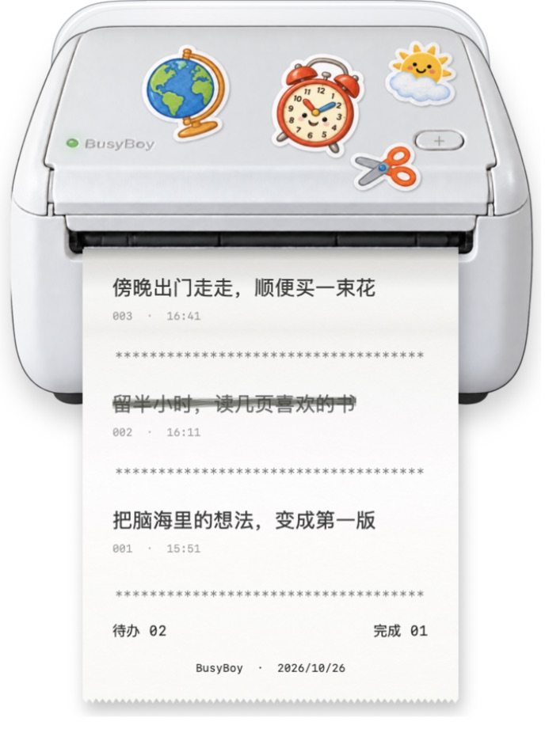
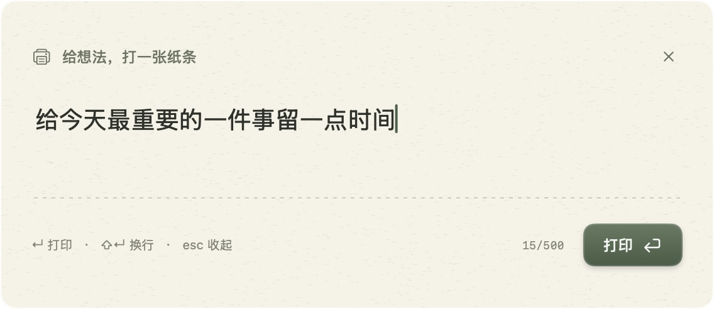
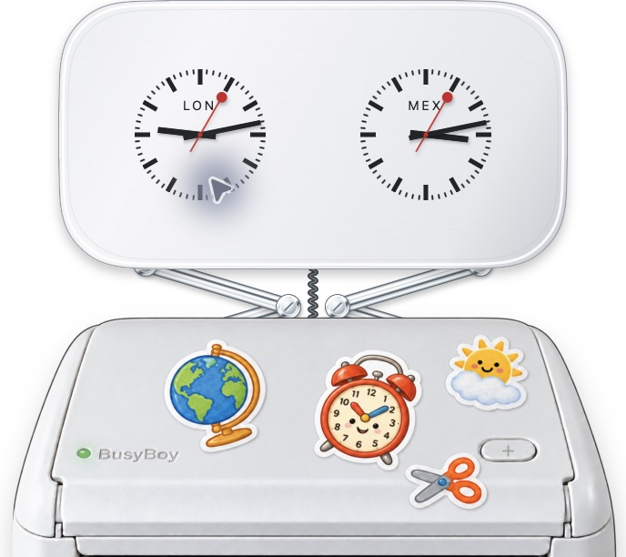

# BusyBoy · 桌面待办机

把待办事项打印在桌面上的一卷热敏纸上。

**macOS 14+ · Apple Silicon · SwiftUI + AppKit · v0.1.0**

[下载 macOS 应用](https://github.com/Kwinliu/BusyBoy/releases/latest) · [图文使用说明](docs/USER_GUIDE.zh-CN.md) · [PDF 说明书](output/pdf/BusyBoy-User-Guide-zh-CN.pdf) · [反馈问题](https://github.com/Kwinliu/BusyBoy/issues)



## 让清单有一点实体感

- **随手记**：`⌃⌥Space` 呼出独立输入框，中文输入法、换行和草稿都能保留。
- **慢慢打印**：绿灯闪烁接收，分段送纸，配合本机合成的打印与机械按键声。
- **划掉、撕下**：点击文字用粗糙的马克笔划掉；剪刀贴纸撕下当前纸条，收进历史。
- **桌面上的小机器**：344 pt 宽的白色拟物机身，可以拖动；默认按普通窗口顺序叠放，按需置顶。
- **三张工具贴纸**：世界时钟、长春天气和绿色数显番茄钟，由亮镍连杆从机身后方托出。
- **本机优先**：待办保存在本机 JSON 文件中，没有账户。只有城市搜索与天气需要联网。

## 安装

1. 到 [Releases](https://github.com/Kwinliu/BusyBoy/releases/latest) 下载 `BusyBoy-v0.1.0-macOS-arm64.zip`。
2. 解压，将 `BusyBoy.app` 拖入“应用程序”，双击启动。
3. 在桌面找到打印机，点击 `+` 或按 `Control + Option + Space` 写第一条待办。

应用常驻菜单栏，不显示普通应用窗口或 Dock 图标。发行包目前只包含 Apple Silicon 版本。

首个公开版本使用临时签名，尚未进行 Apple Developer ID 签名和公证。macOS 首次打开时可能显示来源检查提示，请先核对下载来源及 Release 中的 SHA-256 校验值，并参考 [Apple 的 App 打开说明](https://support.apple.com/zh-cn/102445)。

## 快速操作

| 操作 | 方法 |
| --- | --- |
| 新增待办 | `⌃⌥Space`，或点击机身 `+` |
| 打印 / 换行 | `Return` / `Shift + Return` |
| 收起输入框 | `Esc`，未提交内容会暂存 |
| 完成或恢复 | 点击纸上的事项文字 |
| 编辑或删除 | 右键点击事项 |
| 撕下当前纸条 | 点击剪刀贴纸，事项归档到历史 |
| 撤销上次清单更改 | `⌘Z` 或设置菜单中的撤销 |
| 移动打印机 | 按住没有贴纸的机身部位拖动 |
| 展开 / 收起工具 | 点击同一张地球、天气或闹钟贴纸 |
| 找回隐藏的打印机 | 菜单栏打印机图标 → 显示桌面打印机 |

### 独立输入框



### 时钟、天气与番茄钟



地球贴纸展开世界时钟，默认伦敦和墨西哥城，可更换城市。太阳云朵贴纸展开天气，默认长春，支持搜索城市。闹钟贴纸展开绿色数显番茄钟，支持专注 / 休息、暂停、重置和时长设置。

截图均来自隔离的演示实例，内容为示例待办；天气与时钟数值会随时间变化。

## 数据与隐私

- 待办文件：`~/Library/Application Support/PaperTodo/todos.json`。
- 撕纸是归档，历史仍保留；支持单步撤销和 JSON 导出备份。
- 城市、声音、窗口置顶和位置等设置保存在本机。
- 没有账户、遥测或麦克风采集。机械声音在本机合成。
- 天气 / 城市搜索使用 [Open-Meteo](https://open-meteo.com/) 与 GeoNames 数据，不向天气服务发送待办内容，不申请定位权限。
- 番茄钟收起面板后继续运行；退出应用后不会自动恢复倒计时。

## 从源码构建

需要 macOS 与 Swift 6.2 Command Line Tools / Xcode。开发目录请放在非 OneDrive、iCloud Drive、Dropbox 的本地短路径。

```sh
git clone https://github.com/Kwinliu/BusyBoy.git
cd BusyBoy
./scripts/build.sh
open dist/纸间.app
```

构建输出文件夹沿用内部名称 `纸间.app`，应用显示名称为 **BusyBoy**。Release 中的安装包使用 `BusyBoy.app`。

```sh
./scripts/test.sh
./scripts/test-stickers.sh
# 以下 UI 检查在已登录的 macOS 图形会话中依次执行。
./scripts/test-input.sh
./scripts/test-drag.sh
./scripts/test-lift.sh
```

`./scripts/build.sh debug` 可构建调试版。`scripts/swift.sh` 会在项目 `.build` 中隔离受影响 Command Line Tools 的重复模块声明与旧接口，不改动系统工具链。

仓库包含已生成的配图 PDF。运行 `./scripts/package-release.sh` 可重新构建，并将应用、说明书和安装提示打包到 `dist/`，同时生成 SHA-256 校验文件。

演示模式使用内存示例，不读写真实清单：

```sh
open dist/纸间.app --args --demo
# --preview 仅供截图检查，会临时置顶，不改变正式置顶设置。
open dist/纸间.app --args --demo --preview
```

## 当前范围

这是 macOS 单机桌面程序，模拟屏幕上的热敏打印机；不连接实体打印设备，不包含云同步、协作或手机端。桌面组件由原生无边框窗口实现，不是 WidgetKit 扩展。快捷键目前固定；如被其他应用占用，可使用机身 `+`。

[素材与服务说明](docs/ASSETS.md) · [完整使用说明](docs/USER_GUIDE.zh-CN.md)
