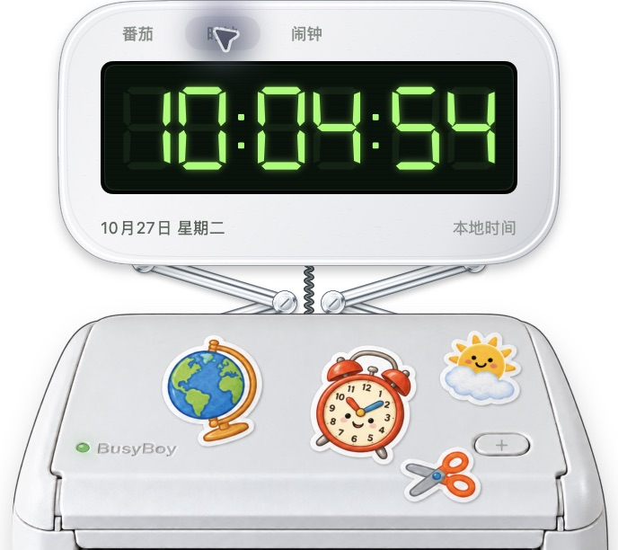
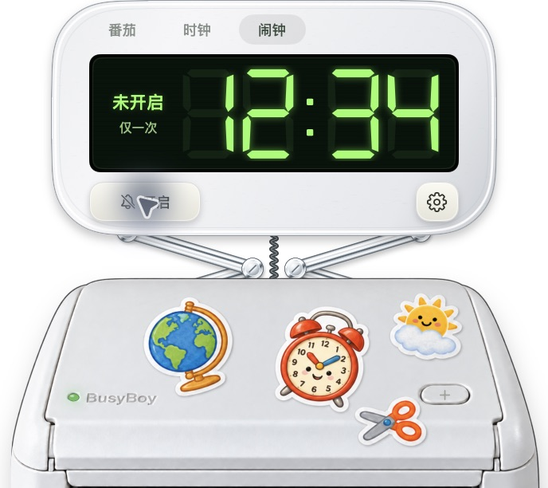
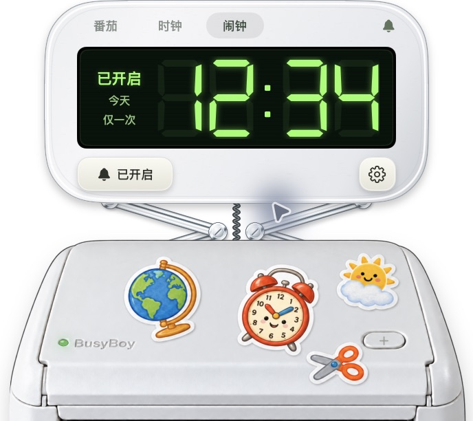

# 番茄、时钟与闹钟

适用于 BusyBoy 0.2.0。

点击机身上的闹钟贴纸，绿色数显面板顶部有三档：

| 档位 | 功能 |
| --- | --- |
| 番茄 | 保留专注 / 休息倒计时，开始、暂停、重置与时长设置。 |
| 时钟 | 按 Mac 的本地时区，以 24 小时制显示时、分、秒，下方显示日期和星期。 |
| 闹钟 | 显示设定时间、今天 / 明天和重复方式，可开启、关闭，点击齿轮设置。 |

“专注 / 休息”、闹钟“已开启 / 未开启”、日期和重复方式均位于绿屏数字左侧，数字下方不放文字。切换档位或收起面板，番茄计时和已开启的闹钟都会继续运行。

## 设置闹钟

1. 切换到“闹钟”，点击齿轮。
2. 设定时、分，选择“仅一次”或“每天”，选择是否开启和响铃，点击“保存”。
3. 数显屏数字左侧会标出“今天 / 明天”和重复方式。如果设定时间已经过去，将安排到明天。

闹钟默认关闭，时间、重复、响铃开关、开启状态和稍后提醒会保存在本机。重新打开应用后继续使用这些设置；单次闹钟触发后自动关闭，每天重复的闹钟按本地日期安排。

| 未开启 | 已开启 |
| --- | --- |
|  |  |

## 到点提醒

到点会弹出同风格的白框绿屏提醒，即使打印机被隐藏也会显示。开启“响铃”时播放独立的清脆提示音；原有机械按键声不变。

- **停止**：结束本次提醒；每天重复的闹钟保留下次安排。
- **稍后 5 分钟**：停止当前提醒，五分钟后再次提醒；单次闹钟也可以使用。
- 无人操作时，响铃和提醒会在一分钟后自动结束。
- 关闭闹钟会同时取消稍后提醒。

闹钟需要应用保持运行，不会唤醒睡眠中的 Mac。唤醒或重开应用时，五分钟内错过的闹钟会补响；更早错过的提醒会跳过，避免连续补响。每天闹钟会继续安排下一次，单次闹钟则关闭。

时钟和闹钟离线工作，跟随 Mac 的本地时区及夏令时。夏令时跳过的时刻顺延到下一个有效时刻；重复出现的时刻每天只响一次。
